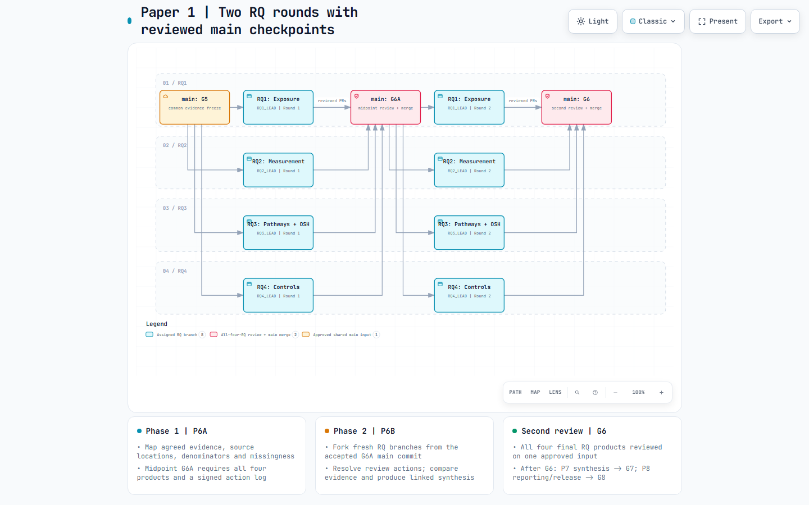
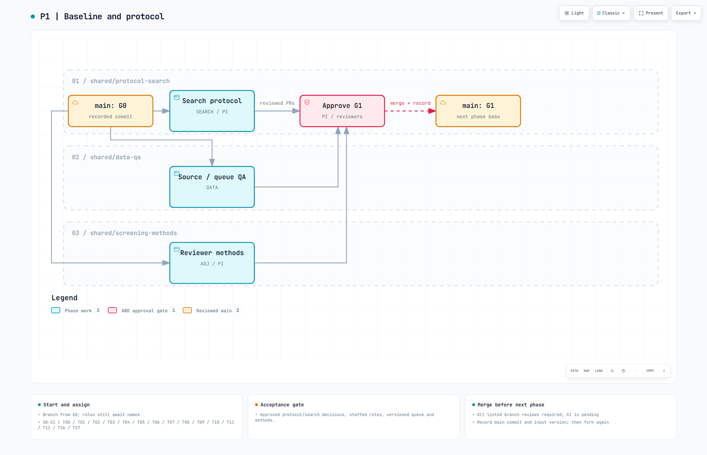
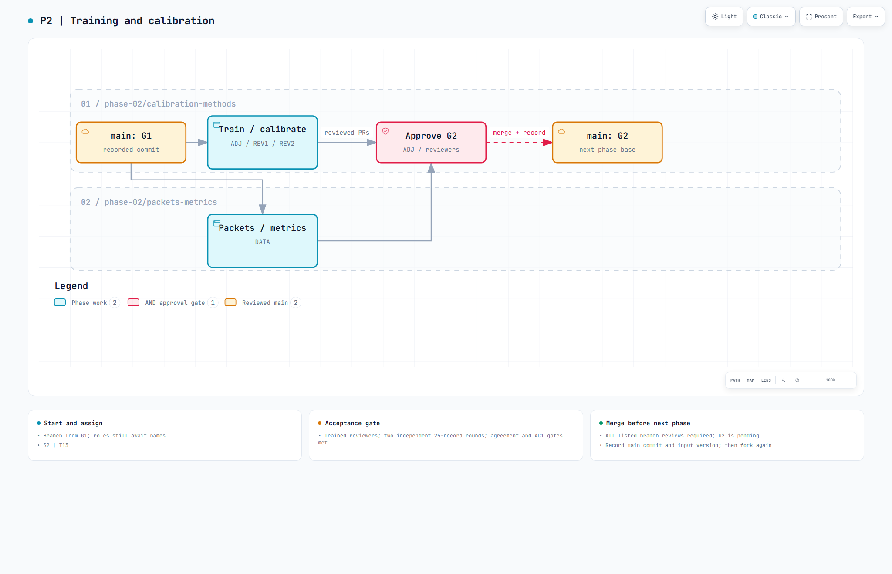
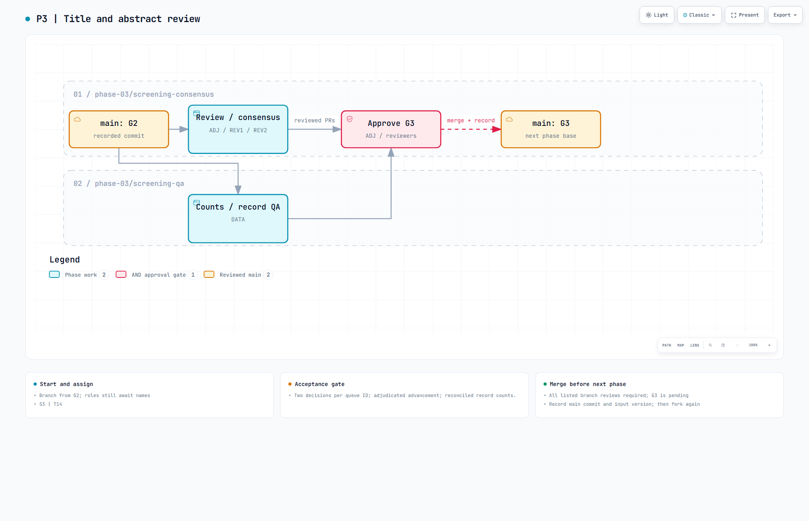
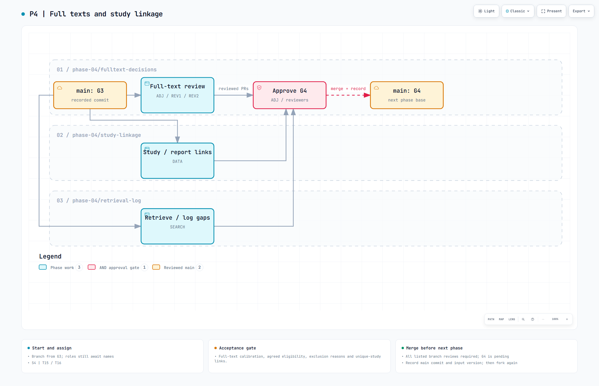
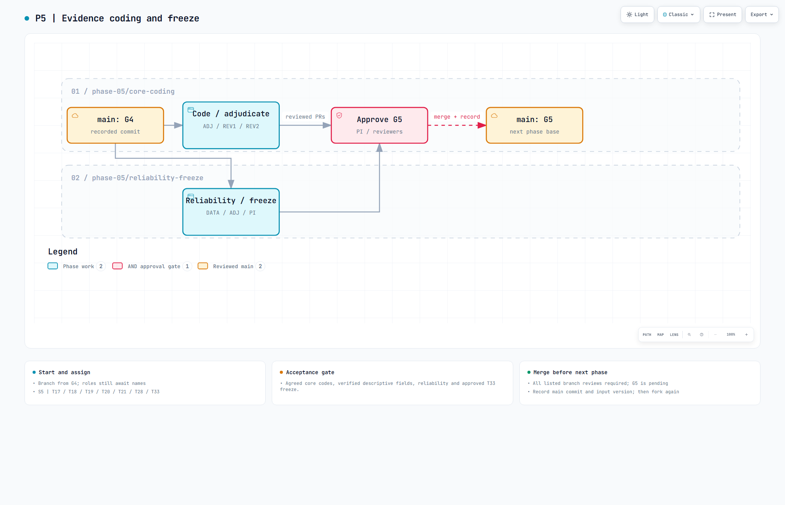
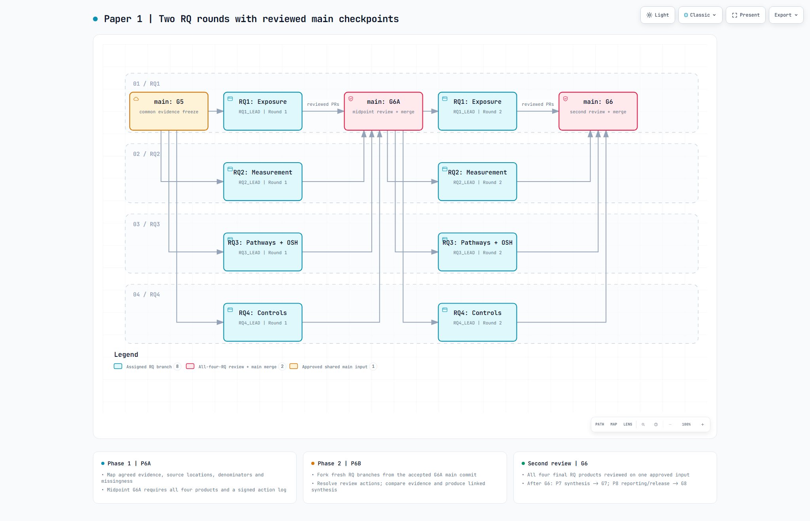
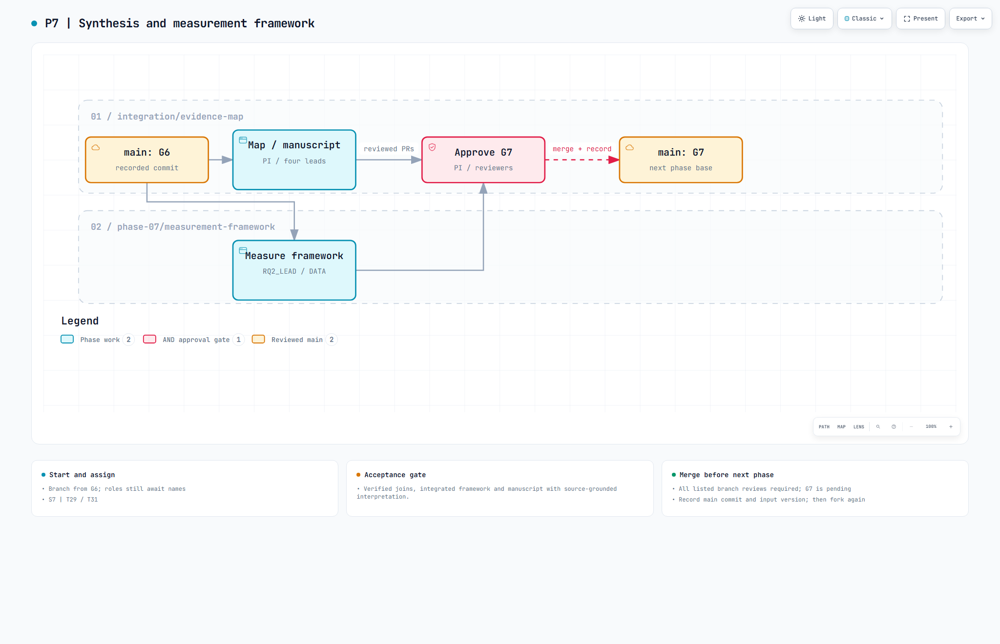

# Phase-by-phase branch and merge workflow

**Execution workflow v0.5, 12 October 2026.** Each phase starts from the preceding approved `main` checkpoint, divides work into phase branches, reviews all required outputs, merges accepted PRs to `main`, and records a new checkpoint before the next phase. Branches, tags and approvals are proposed; none are created by this plan. The scientific S0-S8 sequence and four RQs are retained.

## Overall sequence

Scientific review of each gate also follows the [five-method phase crosswalk](METHODOLOGY_AND_PHASE_CROSSWALK.md). Shared branches own protocol/search/method records; all four RQ branches use that common approved procedure. Track PRESS/registration evidence at G1 and completed reporting checklists at G8 separately from Git merge status.

**Current design: [two RQ rounds with reviewed main checkpoints](../diagrams/paper1_rq_rounds_workflow.html).**

P1-P5 establish the common G5 foundation. P6A has four RQ evidence-mapping branches. The midpoint G6A records four accepted products and the signed correction/round-2 plan. Fresh P6B branches perform linked synthesis; the second evaluation accepts all final RQ products at G6. P7 integration starts only from G6; P8 starts from G7.

The [phase execution playbook](PHASE_EXECUTION_PLAYBOOK.md) details work, files, owners, reviews and failed-gate handling. [Round checkpoints](../tracking/rq_round_checkpoints.csv), [32 RQ work items](../tracking/rq_round_workplan.csv) and the [action log](../tracking/rq_review_actions.csv) are editable operational records. Use the [phase navigator](../diagrams/paper1_phase_navigator.html) for phase details. The [diagram receipt](../diagrams/paper1_rq_rounds_workflow.receipt.json) records exact bytes and separate validation/browser/image-review evidence.

The detailed diagram for each phase separates the previous `main` baseline, work branches, an **AND approval gate**, and the newly accepted `main` baseline. Every displayed work branch must have accepted evidence. Unlabeled fork arrows mean the common baseline; return arrows share the reviewed-PR meaning shown once. Diagram arrows represent approval dependencies, not individual Git commits.

## Phase and merge register

| Phase / stages | Work before merging | Checkpoint / next base | Accountable role |
|---|---|---|---|
| P1 / S0-S1 | Baseline and protocol | `G0` -> `G1` | PI |
| P2 / S2 | Training and calibration | `G1` -> `G2` | ADJ |
| P3 / S3 | Title and abstract review | `G2` -> `G3` | ADJ |
| P4 / S4 | Full texts and study linkage | `G3` -> `G4` | ADJ |
| P5 / S5 | Evidence coding and freeze | `G4` -> `G5` | PI |
| P6 / S6 | RQ round 1, midpoint review, round 2 and second evaluation | `G5` -> `G6A` -> `G6` | PI |
| P7 / S7 | Synthesis and measurement framework | `G6` -> `G7` | PI |
| P8 / S8 | Reporting and final release | `G7` -> `G8` | PI |

The editable [merge register](../tracking/phase_merge_plan.csv) holds gate evidence, input version/hash, accepted main commit and approver/date. [Branch work table](../tracking/branch_plan.csv) records all 26 branch scopes/actions; [tasks](../tracking/tasks.csv) keep the original 34 task IDs, scientific dependencies, status and dates, with new phase/checkpoint columns.

Most phases have two to four work branches. P6 has four active RQ branches in each round and a PI review-record branch after each round. Role holders carry responsibilities across phases; 26 is the total planned branch count across the project. During long screening/coding phases, approved batch or weekly progress PRs may merge to main while the whole-phase checkpoint remains pending. The next formal phase still requires the complete gate.

Use the [checkpoint acceptance template](../templates/PHASE_CHECKPOINT.md) for each promotion decision. The unified overview, navigator and eight detailed diagrams are the primary operational handoff. Older overview diagrams retain a large-screen whitespace limitation. G0 denotes the starting repository package, not a scientific eligibility or evidence approval.

## Rules applied at every phase

1. PI/maintainer confirms that the previous checkpoint is approved and records its immutable main commit. Create every phase branch from that commit, with a named owner and separate human reviewer.
2. The owner completes the listed scope and attaches task IDs, source evidence, commands, versions and acceptance checks to a PR targeting `main`. Auxiliary branches use the same task ID with separate sub-issues; a task has one primary branch in the task board.
3. Technical checks may run automatically. Human scientific approvals remain required. PRs may merge individually after review, but the phase checkpoint stays pending until **all** required branches and acceptance conditions are complete. A partial main merge does not open the next phase.
4. DATA verifies IDs, counts, input versions/hashes and approved-data provenance. The accountable gate owner records the final accepted main commit, evidence location and approvals in the register. Then, and only then, create the next phase branches.
5. Close/delete merged remote work branches when the maintainer chooses; use fresh branches for later phases. Optional baseline tags name approved commits and are not substitutes for evidence. No tags exist merely because their names are listed.

Formal phase promotion is sequential. Full-text retrieval or extraction on approved batches may run as explicitly provisional work while a previous whole-corpus gate is pending; it cannot mark later whole-corpus gates complete or support final RQ counts. Dates follow observed throughput and existing task targets, not an assumed weekly merge.

## P1. Baseline and protocol (S0-S1)

[Interactive diagram](../diagrams/paper1_p1_branches.html). **Start:** approved `G0` main commit. **Merge destination:** `main`. **Gate:** `G1`. **Tasks:** T00, T01, T02, T03, T04, T05, T06, T07, T08, T09, T10, T11, T12, T26, T27.

| Branch | Owner | Work / accepted output | Reviewers |
|---|---|---|---|
| `shared/protocol-search` | SEARCH | Resolve dates/hits/export caps; PRESS; sign criteria/RQs/cutoff and register protocol; staff roles | PI, independent_PRESS_reviewer |
| `shared/data-qa` | DATA | Check hashes/IDs/DOI exceptions; recover abstracts; version the approved screening queue | SEARCH, ADJ |
| `shared/screening-methods` | ADJ | Approve independent screening and coding SOP; field tiers; reliability and AI rules | PI, DATA |

**What must be completed before promotion:** Approved protocol/search decisions, staffed roles, versioned queue and methods. Record `G1` with the accepted main commit, input version/hash, evidence location and approver/date. Proposed tag: `review-baseline-v1`.

**Current level:** bibliographic metadata preparation (T00/T01/T27) is documented; search reconciliation, staffing and protocol gates remain pending. The 6,592-record working-year queue is provisional until approved. The main checkpoint must not imply a completed search solely from file availability.

## P2. Training and calibration (S2)

[Interactive diagram](../diagrams/paper1_p2_branches.html). **Start:** approved `G1` main commit. **Merge destination:** `main`. **Gate:** `G2`. **Tasks:** T13.

| Branch | Owner | Work / accepted output | Reviewers |
|---|---|---|---|
| `phase-02/calibration-methods` | ADJ | Train and competency-check both reviewers; run two disjoint 25-record rounds; refine methods | PI, DATA |
| `phase-02/packets-metrics` | DATA | Issue separated reviewer packets; preserve original decisions; calculate pre-consensus statistics | ADJ |

**What must be completed before promotion:** Trained reviewers; two independent 25-record rounds; agreement and AC1 gates met. Record `G2` with the accepted main commit, input version/hash, evidence location and approver/date. Proposed tag: `review-calibration-v1`.

**Calibration gate:** train/competency-check first; use two disjoint random 25-record rounds, revising between rounds. The prespecified project targets are >=85% agreement and AC1 >=0.80; report supplementary kappa. Repeat/refine if the gate fails. Original decisions remain separate in controlled storage.

## P3. Title and abstract review (S3)

[Interactive diagram](../diagrams/paper1_p3_branches.html). **Start:** approved `G2` main commit. **Merge destination:** `main`. **Gate:** `G3`. **Tasks:** T14.

| Branch | Owner | Work / accepted output | Reviewers |
|---|---|---|---|
| `phase-03/screening-consensus` | ADJ | Both reviewers assess every queue ID; discuss disagreements; ADJ resolves remaining cases | PI, DATA |
| `phase-03/screening-qa` | DATA | Audit decision coverage and reasons; reconcile advancement and duplicate/count exceptions | ADJ |

**What must be completed before promotion:** Two decisions per queue ID; adjudicated advancement; reconciled record counts. Record `G3` with the accepted main commit, input version/hash, evidence location and approver/date. Proposed tag: `review-screened-v1`.

**Queue completion:** REV1 and REV2 independently assess the same full approved queue. RQ keywords do not partition eligibility work. Missing abstracts/no RQ hints are not automatic exclusions. Git receives methods/code and approved shareable summaries; independent decisions stay controlled.

## P4. Full texts and study linkage (S4)

[Interactive diagram](../diagrams/paper1_p4_branches.html). **Start:** approved `G3` main commit. **Merge destination:** `main`. **Gate:** `G4`. **Tasks:** T15, T16.

| Branch | Owner | Work / accepted output | Reviewers |
|---|---|---|---|
| `phase-04/fulltext-decisions` | ADJ | Separate 10-15-report calibration; dual full-text eligibility; agree decisions and exclusion reasons | PI, DATA |
| `phase-04/study-linkage` | DATA | Link reports to unique studies; verify multi-report/multi-RQ identity and registry consistency | ADJ |
| `phase-04/retrieval-log` | SEARCH | Retrieve reports; record requests, failures, recovery source and access limitations | ADJ, DATA |

**What must be completed before promotion:** Full-text calibration, agreed eligibility, exclusion reasons and unique-study links. Record `G4` with the accepted main commit, input version/hash, evidence location and approver/date. Proposed tag: `review-eligible-v1`.

**Full-text gate:** separate 10-15-report calibration, with >=90% agreement and AC1 >=0.80; then dual eligibility decisions, reasons, retrieval-failure accounting and record/report/study crosswalk. Counts remain report- and study-specific.

## P5. Evidence coding and freeze (S5)

[Interactive diagram](../diagrams/paper1_p5_branches.html). **Start:** approved `G4` main commit. **Merge destination:** `main`. **Gate:** `G5`. **Tasks:** T17, T18, T19, T20, T21, T28, T33.

| Branch | Owner | Work / accepted output | Reviewers |
|---|---|---|---|
| `phase-05/core-coding` | ADJ | Independently double-code core fields; verify all descriptive fields; adjudicate; refine/recode as required | PI, DATA |
| `phase-05/reliability-freeze` | DATA | Validate fields/keys; calculate prespecified pre-consensus reliability; package approved T33 freeze | ADJ, PI |

**What must be completed before promotion:** Agreed core codes, verified descriptive fields, reliability and approved T33 freeze. Record `G5` with the accepted main commit, input version/hash, evidence location and approver/date. Proposed tag: `review-evidence-v1`.

**Evidence gate:** 100% independent double coding of core fields; descriptive extraction plus 100% verification. Calculate prespecified reliability before consensus, refine/recode as required, and preserve original coder records. DATA packages T33 only after agreed codes/reliability are approved. `G5` binds protocol/codebook versions and agreed evidence hashes; the bibliographic snapshot is not this freeze.

## P6. Two RQ rounds and evaluations (S6)

[Interactive diagram](../diagrams/paper1_rq_rounds_workflow.html) | [Detailed work and outputs](PHASE_EXECUTION_PLAYBOOK.md). Start from approved G5. All PRs target main. First accept G6A, then create fresh round-2 branches and accept G6.

| RQ | Round 1 / task | Round 2 / task | Owner | Review |
|---|---|---|---|---|
| RQ1 | `analysis/rq1-exposure` / T22 | `analysis/rq1-exposure-r2` / T35 | RQ1_LEAD | RQ2_LEAD, DATA |
| RQ2 | `analysis/rq2-measurement` / T30 | `analysis/rq2-measurement-r2` / T36 | RQ2_LEAD | RQ1_LEAD, DATA |
| RQ3 | `analysis/rq3-pathways-outcomes` / T23 | `analysis/rq3-pathways-outcomes-r2` / T37 | RQ3_LEAD | RQ4_LEAD, DATA |
| RQ4 | `analysis/rq4-controls` / T24 | `analysis/rq4-controls-r2` / T38 | RQ4_LEAD | RQ3_LEAD, DATA |

**P6A / round 1:** source-linked inventories, descriptive matrices, missingness and common-input/unique-study QA. PI owns T34 / `review/rq-round1`; all four products and the signed review action plan establish **G6A**.

**P6B / round 2:** fresh branches from G6A; resolve midpoint actions, compare compatible designs/contexts/measurements, join evidence and write verified final claims. PI owns T39 / `review/rq-round2`; all four final products, resolved blocking actions, reproducibility and source checks establish **G6**.

Record approvals in [rq_round_checkpoints.csv](../tracking/rq_round_checkpoints.csv); G6 also completes the outer P6 record. Use [RQ_ROUND_REVIEW.md](../templates/RQ_ROUND_REVIEW.md). Scientific changes return to ADJ/DATA and may require a newly approved common freeze and reruns. Review-record branches record the decisions; they do not replace four RQ cross-reviews.

## P7. Synthesis and measurement framework (S7)

[Interactive diagram](../diagrams/paper1_p7_branches.html). **Start:** approved `G6` main commit. **Merge destination:** `main`. **Gate:** `G7`. **Tasks:** T29, T31.

| Branch | Owner | Work / accepted output | Reviewers |
|---|---|---|---|
| `integration/evidence-map` | PI | Join accepted RQ products; reconcile denominators; draft integrated map/narrative and novelty comparison | RQ1_LEAD, RQ2_LEAD, RQ3_LEAD, RQ4_LEAD, DATA |
| `phase-07/measurement-framework` | RQ2_LEAD | Build measurement framework with inputs from all four leads; distinguish future experiment candidates | RQ1_LEAD, RQ3_LEAD, RQ4_LEAD, DATA, PI |

**What must be completed before promotion:** Verified joins, integrated framework and manuscript with source-grounded interpretation. Record `G7` with the accepted main commit, input version/hash, evidence location and approver/date. Proposed tag: `review-synthesis-v1`.

**Fresh integration:** create `integration/evidence-map` and the measurement-framework branch from accepted `G6` main, not from G5. The framework branch owns `analysis/integrated/measurement/`; the PI branch owns map/manuscript outputs. Verify RQ1/RQ2 exposure-measure joins, then pathway/outcome/control links and study-level denominators. Their development may run in parallel; all accepted outputs are required for G7.

## P8. Reporting and final release (S8)

[Interactive diagram](../diagrams/paper1_p8_branches.html). **Start:** approved `G7` main commit. **Merge destination:** `main`. **Gate:** `G8`. **Tasks:** T25, T32.

| Branch | Owner | Work / accepted output | Reviewers |
|---|---|---|---|
| `phase-08/reporting-search` | PI | Verify PRISMA-ScR/S tables, dates/limits/search amendments and reliability/AI disclosures | DATA, RQ1_LEAD, RQ2_LEAD, RQ3_LEAD, RQ4_LEAD |
| `phase-08/release-qa` | PI | Reproduce outputs; verify source locators and claims; check links/package; obtain PI final approval | SEARCH, DATA, RQ1_LEAD, RQ2_LEAD, RQ3_LEAD, RQ4_LEAD |

**What must be completed before promotion:** Search/reporting disclosures, source/claim verification, reproducibility and PI release approval. Record `G8` with the accepted main commit, input version/hash, evidence location and approver/date. Proposed tag: `review-release-v1`.

**Release is separate from synthesis:** audit PRISMA/search/reliability disclosures, adjacent-review/novelty and source claims, reproducibility and package integrity. If a source or scientific code is wrong, return it to ADJ/DATA, issue an approved amended evidence version, and rerun affected products. Do not hide the correction inside a technical merge. G8 requires PI acceptance; upload/submission is handled separately by the user/team.

## Automation and evidence boundaries

| Automation | Required human review |
|---|---|
| P1 manifests, missingness, provenance/count checks | Search histories, scope/period/eligibility approval and ambiguous duplicate decisions |
| P2 packet/sampling checks and agreement calculations | Independent judgments, competency and calibration acceptance |
| P3-P4 coverage, count reconciliation and link validators | Eligibility/adjudication, full-text decisions and study linkage |
| P5 schema/field checks, prespecified reliability, hashes | Core interpretation, reliability assessment, recoding and agreed freeze approval |
| P6-P7 matrices, joins, figures and unique-study denominators | Source locators, interpretation, measurement properties and causal limits |
| P8 reproducibility, link/package checks and reporting counts | Claim/source verification and final PI approval |

Existing scripts cover metadata audit, sampling/readiness and upload checks. Decision/reliability/RQ-analysis automation is planned until implemented against the signed schema and actual approved data. Git stores code and approved shareable outputs; canonical evidence and independent reviewer decisions remain in controlled storage.

## Verification and previous diagram

Each linked Archify artifact has its own specification, delivery hash summary and automated-browser captures. See [diagram index and receipts](../diagrams/README.md). Browser checks cover default READ/Still at four desktop sizes; image review is separate. Other interactive modes/exports are not independently tested.

Use the current two-round diagram and phase register for execution.
