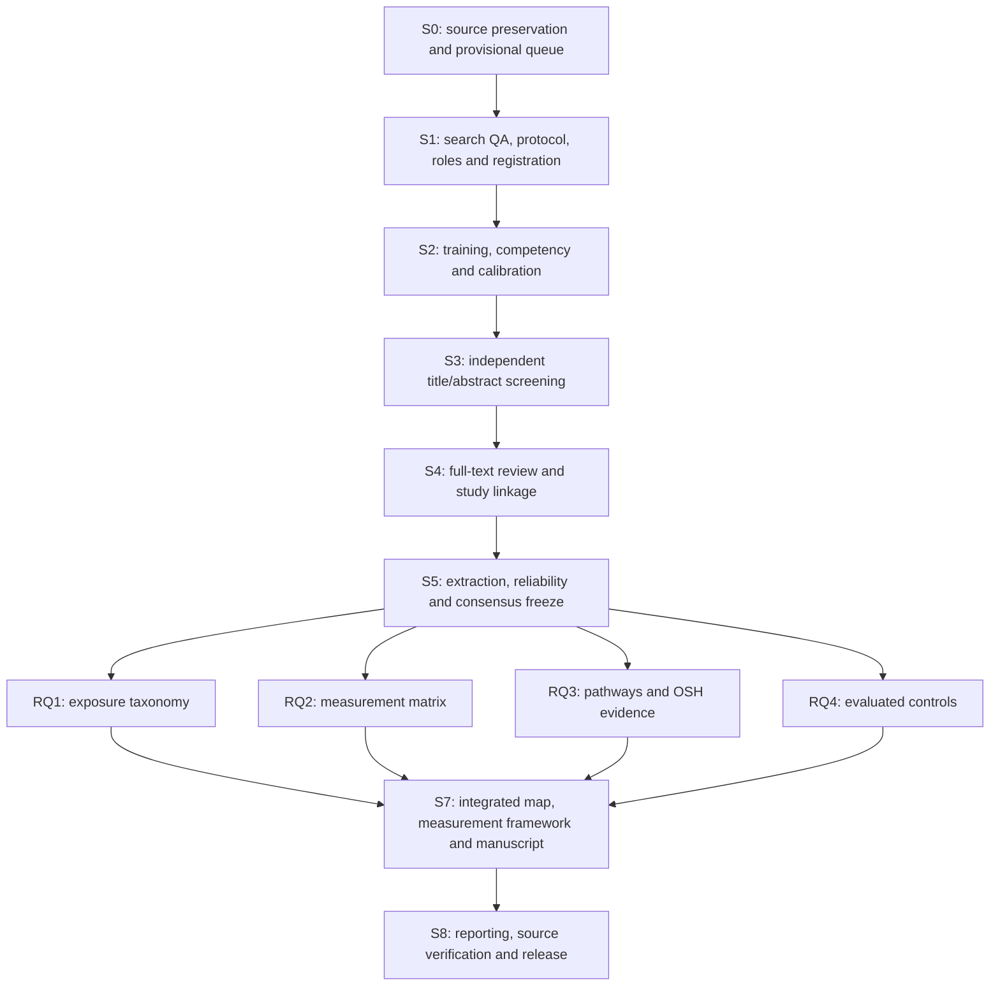

# Research stages, dependencies, and branch plan

**Working implementation plan: 12 October 2026.** The stages below separate preparation, independent scientific decisions, and RQ analysis. Planned dates are scheduling assumptions. A gate is completed only with its named owner, evidence and approval; a prepared template is not a scientific result.

## 1. Stage map

See the [Archify branch workflow and responsibilities](BRANCH_WORKFLOW_GUIDE.md) for the interactive diagram, GitHub image preview, exact branch names, PR reviewers and merge destinations.

| Stage | Method and input | Output / completion gate | Accountable owner; execution | Task IDs / planning window |
|---|---|---|---|---|
| **S0: preserve and organize** | Audit exports; normalize; flag duplicate candidates; prepare year-window queue | Hashes, stable IDs and counts; provisional status retained | DATA; DATA | T00, T01, T27: metadata preparation completed 12 October |
| **S1: resolve scope and search** | Reconcile histories/counts; investigate caps/conflicts; sentinel coverage; independent PRESS; lock PCC/RQs/types/cutoff/AI/reliability | Signed protocol and roles, search-gap/update decisions, registration reference, versioned queue | PI; SEARCH, DATA, ADJ | T02-T12, T26: target 12-16 October; depends on actual access/review |
| **S2: train/calibrate** | Mixed training pool and competency check; random 25, refine, fresh random 25 | Source targets: agreement >=85%, AC1 >=0.80; report kappa; substantive-error review; trained reviewers and codebook freeze | ADJ; REV1 and REV2 independently, DATA computes | T13: target 19-23 October; repeat if gate fails |
| **S3: screen records** | Both reviewers independently screen every record in the approved queue; preserve originals; resolve disagreement | Two decisions per record, pre-consensus statistics, agreed advancement and reasons; no keyword-based stopping | ADJ; REV1 and REV2, DATA logs | T14: from 26 October, after S2 |
| **S4: assess reports/link studies** | Recover full text; separate 10-15-report calibration, target >=90% agreement and AC1 >=0.80; dual eligibility review; report-study linkage | Full-text decisions/reasons, retrieval failures, unique study registry and source locators | ADJ; REV1/REV2; DATA owns linkage | T15, T16: timing follows observed S3 throughput |
| **S5: chart and freeze evidence** | 100% independent core double coding; one descriptive extraction plus 100% verification; calculate prespecified reliability before consensus; refine/recode where required | Approved registry/evidence-link/reliability tables, codebook and hashes; no unresolved core interpretation in analysis inputs | ADJ; REV1/REV2, DATA | T17-T21, T28; follows eligible reports |
| **S6: analyze four RQs** | Four leads analyze the same frozen agreed study-level data; descriptive/relational tables, gaps and narrative; source verification | Four reviewed RQ products with shared input/version/denominators; all multi-RQ contributions linked | Each RQ lead; other leads review | T22, T23, T24, T30 plus T34-T39; two rounds and two review checkpoints |
| **S7: integrate** | Join four accepted products by study/exposure/measure/outcome/control IDs; build measurement framework; reconcile denominators and contradictory interpretation | Integrated evidence map/framework and manuscript; limits/novelty tied to sources; proposed experiments separate | PI; all RQ leads, DATA | T29, T31; after four accepted RQ products |
| **S8: reporting/release** | Source/claim/adjacent-review checks; PRISMA-ScR/S; search amendments and reliability disclosures; upload QA | Final reviewed manuscript/supplement package and approved release PR | PI; SEARCH, DATA, all leads | T25, T32; after integrated review |

Stages can overlap for **completed and approved batches**. Full-text collection can begin for agreed advanced records while S3 continues; extraction can start for agreed included studies. Final counts and final RQ synthesis require a reconciled whole-corpus freeze. Any interim RQ product must name its batch, missing coverage, and provisional status.

## 2. Roles and RQ boundaries

- RQ1 and RQ2 have separate accountable leads and branches. One author may hold both roles; their deliverables and review records remain separate. Existing G12 identifies their coordination bundle.
- RQ3 has one accountable lead with RQ3a pathway and RQ3b outcome/support subdomains in each round-specific branch. It can have two contributors under one accountable lead.
- RQ4 is the current controls question, previously RQ5.
- REV1/REV2 judge the same full queue and core evidence fields independently. RQ leads develop coverage/analysis and interpret agreed data. They do not replace the independent coder pair.
- SEARCH controls search changes; DATA controls canonical IDs, input freezes and count generation; ADJ controls unresolved scientific coding; PI approves scope, interpretation and final integration.

The editable [task board](../tracking/tasks.csv), [stage table](../tracking/stages.csv), [RQ assignments](../tracking/rq_assignments.csv), and [role roster](../tracking/assignments.csv) define responsibility. `owner_role` means execution responsibility; `accountable_role` is the single role responsible for delivery and the gate. Blank assignees mean actual people still need to be named.

## 3. Phase branches and main checkpoints

The execution workflow now uses eight sequential phase checkpoints: P1 S0-S1 -> G1; P2 S2 -> G2; P3 S3 -> G3; P4 S4 -> G4; P5 S5 -> G5; P6 S6 -> midpoint G6A -> second evaluation G6; P7 S7 -> G7; P8 S8 -> G8. Every phase forks from the preceding approved main commit and submits reviewed PRs back to main. All required phase outputs and approvals must be complete before the next phase starts.

See the [phase diagrams and work guide](BRANCH_WORKFLOW_GUIDE.md), [26-branch work table](../tracking/branch_plan.csv), and [merge register](../tracking/phase_merge_plan.csv). Names/tags are proposed and all scientific checkpoints remain pending. Metadata preparation alone does not approve G1.

## 4. Merge and integration order

1. P1 search/protocol, data QA and reviewer methods establish G1. P2 calibration establishes G2. P3 complete title/abstract decisions establish G3. P4 full-text eligibility and study linkage establish G4.
2. P5 independent coding/verification, prespecified reliability and adjudication produce T33 and the approved G5 evidence freeze. Record protocol/codebook/registry/evidence versions and hashes.
3. Create four round-1 RQ branches from G5 main; cross-review inventories and accept midpoint G6A through T34. Create four fresh round-2 branches from G6A; cross-review linked synthesis and accept second evaluation G6 through T39. DATA verifies common inputs, IDs and denominators in both rounds.
4. Create fresh P7 integration and measurement-framework branches from accepted G6. Join exposure/measurement first, then pathway/outcome/control links. T29/T31 and all required reviews establish G7.
5. Create separate P8 reporting/search and release-QA branches from G7. T25/T32, source/claim checks, reproducibility and PI approval establish G8 and the accepted main release.

Each gate records the accepted main commit, input version/hash, evidence path, approver and date. Individual PR merges do not promote an incomplete phase. Task branches start from the approved phase/round baseline and submit reviewed PRs to main. Scope/code corrections return to ADJ/DATA, issue an approved common version and reopen affected gates for reruns. Do not resolve conflicting evidence rows with a technical ours/theirs choice.

## 5. Automation implementation boundary

| Available now | Required human verification |
|---|---|
| Survey snapshot/hash audit; upload/package checks | Original sources, platform histories and appropriate sharing scope |
| Mixed training manifest; disjoint random calibration manifest | Competency, calibration decisions and statistic interpretation |
| Four-RQ readiness union with input hashes | Final eligibility/RQ codes; hint pools do not select studies |

Packet validators, disagreement tables, reliability calculations, approved-code summaries, relational-map/PRISMA count scripts, and analysis reproduction scripts are **planned follow-on implementations**. Build them using the signed schema and real decision data. Store code and aggregate approved outputs in their appropriate shared/RQ directories; preserve independent reviewer decisions in the controlled data storage. Do not generate fabricated demonstration findings to fill the blank scientific templates.

Each automation records its tool/version, input hash, command, output path and date. It may flag missing data or compute approved-code summaries; eligibility, mechanism interpretation, causal/effect claims and final review conclusions remain human decisions.

## Two-round execution amendment v0.5

P6A evidence mapping -> G6A midpoint -> fresh P6B linked synthesis -> G6 second evaluation precedes P7 integration. Read the [phase execution playbook](PHASE_EXECUTION_PLAYBOOK.md) and use [32 RQ work items](../tracking/rq_round_workplan.csv) and [round checkpoints](../tracking/rq_round_checkpoints.csv). Scientific S0-S8 stages are retained; T34-T39 add the reviews and second-round outputs.
