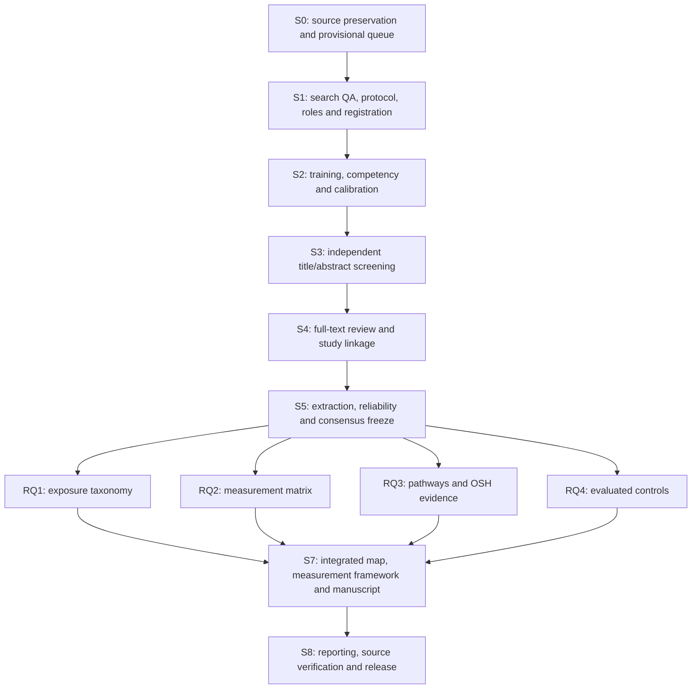

# Research stages, dependencies, and branch plan

**Working implementation plan: 12 October 2026.** The stages below separate preparation, independent scientific decisions, and RQ analysis. Planned dates are scheduling assumptions. A gate is completed only with its named owner, evidence and approval; a prepared template is not a scientific result.

## 1. Stage map

| Stage | Method and input | Output / completion gate | Accountable owner; execution | Task IDs / planning window |
|---|---|---|---|---|
| **S0: preserve and organize** | Audit exports; normalize; flag duplicate candidates; prepare year-window queue | Hashes, stable IDs and counts; provisional status retained | DATA; DATA | T00, T01, T27: metadata preparation completed 12 October |
| **S1: resolve scope and search** | Reconcile histories/counts; investigate caps/conflicts; sentinel coverage; independent PRESS; lock PCC/RQs/types/cutoff/AI/reliability | Signed protocol and roles, search-gap/update decisions, registration reference, versioned queue | PI; SEARCH, DATA, ADJ | T02-T12, T26: target 12-16 October; depends on actual access/review |
| **S2: train/calibrate** | Mixed training pool and competency check; random 25, refine, fresh random 25 | Source targets: agreement >=85%, AC1 >=0.80; report kappa; substantive-error review; trained reviewers and codebook freeze | ADJ; REV1 and REV2 independently, DATA computes | T13: target 19-23 October; repeat if gate fails |
| **S3: screen records** | Both reviewers independently screen every record in the approved queue; preserve originals; resolve disagreement | Two decisions per record, pre-consensus statistics, agreed advancement and reasons; no keyword-based stopping | ADJ; REV1 and REV2, DATA logs | T14: from 26 October, after S2 |
| **S4: assess reports/link studies** | Recover full text; separate 10-15-report calibration, target >=90% agreement and AC1 >=0.80; dual eligibility review; report-study linkage | Full-text decisions/reasons, retrieval failures, unique study registry and source locators | ADJ; REV1/REV2; DATA owns linkage | T15, T16: timing follows observed S3 throughput |
| **S5: chart and freeze evidence** | 100% independent core double coding; one descriptive extraction plus 100% verification; calculate prespecified reliability before consensus; refine/recode where required | Approved registry/evidence-link/reliability tables, codebook and hashes; no unresolved core interpretation in analysis inputs | ADJ; REV1/REV2, DATA | T17-T21, T28; follows eligible reports |
| **S6: analyze four RQs** | Four leads analyze the same frozen agreed study-level data; descriptive/relational tables, gaps and narrative; source verification | Four reviewed RQ products with shared input/version/denominators; all multi-RQ contributions linked | Each RQ lead; other leads review | T22, T23, T24, T30; separate analysis branches |
| **S7: integrate** | Join four accepted products by study/exposure/measure/outcome/control IDs; build measurement framework; reconcile denominators and contradictory interpretation | Integrated evidence map/framework and manuscript; limits/novelty tied to sources; proposed experiments separate | PI; all RQ leads, DATA | T29, T31; after four accepted RQ products |
| **S8: reporting/release** | Source/claim/adjacent-review checks; PRISMA-ScR/S; search amendments and reliability disclosures; upload QA | Final reviewed manuscript/supplement package and approved release PR | PI; SEARCH, DATA, all leads | T25, T32; after integrated review |

Stages can overlap for **completed and approved batches**. Full-text collection can begin for agreed advanced records while S3 continues; extraction can start for agreed included studies. Final counts and final RQ synthesis require a reconciled whole-corpus freeze. Any interim RQ product must name its batch, missing coverage, and provisional status.

## 2. Roles and RQ boundaries

- RQ1 and RQ2 have separate accountable leads and branches. One author may hold both roles; their deliverables and review records remain separate. Existing G12 identifies their coordination bundle.
- RQ3 is one branch with RQ3a pathway and RQ3b outcome/support subdomains. It can have two contributors under one accountable lead.
- RQ4 is the current controls question, previously RQ5.
- REV1/REV2 judge the same full queue and core evidence fields independently. RQ leads develop coverage/analysis and interpret agreed data. They do not replace the independent coder pair.
- SEARCH controls search changes; DATA controls canonical IDs, input freezes and count generation; ADJ controls unresolved scientific coding; PI approves scope, interpretation and final integration.

The editable [task board](../tracking/tasks.csv), [stage table](../tracking/stages.csv), [RQ assignments](../tracking/rq_assignments.csv), and [role roster](../tracking/assignments.csv) define responsibility. `owner_role` means execution responsibility; `accountable_role` is the single role responsible for delivery and the gate. Blank assignees mean actual people still need to be named.

## 3. Concrete branch structure

All names below are **proposed branches**, not branches already created. `main` is the reviewed reference. Shared method/data PRs establish the baseline before RQ analysis. See the editable [branch table](../tracking/branch_plan.csv).

| Branch | Responsible role | Main writable scope | PR destination / review |
|---|---|---|---|
| `shared/protocol-search` | SEARCH; PI approves | Search log, criteria, protocol decisions/amendments, methods documents | `main`; independent search review evidence + PI |
| `shared/data-qa` | DATA | Manifests, queue/linkage QA scripts, freeze metadata, data documentation | `main`; SEARCH or ADJ for source/ID decisions |
| `shared/screening-methods` | ADJ | SOP, codebook/reliability specifications, blank packet templates | `main`; PI and DATA; independent decisions stay in controlled separate files |
| `analysis/rq1-exposure` | RQ1_LEAD | `analysis/rq1/`; its scripts, tables, figures, narrative | `integration/evidence-map`; RQ2_LEAD + DATA |
| `analysis/rq2-measurement` | RQ2_LEAD | `analysis/rq2/`; its scripts, tables, figures, narrative | `integration/evidence-map`; RQ1_LEAD + DATA |
| `analysis/rq3-pathways-outcomes` | RQ3_LEAD | `analysis/rq3/`; linked RQ3a/RQ3b products | `integration/evidence-map`; RQ4_LEAD + DATA |
| `analysis/rq4-controls` | RQ4_LEAD | `analysis/rq4/`; empirical controls and separate proposals | `integration/evidence-map`; RQ3_LEAD + DATA |
| `integration/evidence-map` | PI | `analysis/integrated/`; integrated map/framework/manuscript | `main`; four leads + DATA + SEARCH for search reporting |

Individual tasks can use a short branch `task/T##-description` based on the relevant shared/RQ branch and open a PR back to it. The responsible domain lead reviews those PRs. Do not leave the task work outside its parent PR's input/version/gate checks.

Each RQ writes its own directory. Shared evidence inputs are read-only to the RQ branches. A coding correction goes to ADJ, followed by a controlled consensus-data revision and a new freeze from DATA; all affected RQ analyses rerun. Branch merging does not resolve scientific disagreements or authorize new codes.

## 4. Integration order and acceptance

1. Merge approved search/protocol, data and screening-method PRs to `main`. Record what remains unresolved and its impact; do not assert completeness solely because the PR merged.
2. After S5, DATA creates a common **agreed-analysis freeze** with protocol/codebook versions, registry/evidence hashes, consensus status, unresolved items and approval in [data_freezes.csv](../tracking/data_freezes.csv). The current metadata snapshot is not this freeze.
3. Create the integration branch and four RQ branches from the same `main` commit. Record that commit plus the evidence freeze in each RQ handoff.
4. Merge accepted RQ1 and RQ2 PRs into the integration branch, verify the exposure-measure join, then merge RQ3 and RQ4 PRs and check their source links. Their development can occur in parallel; no finished analysis is claimed now.
5. DATA reconciles unique-study denominators and report links; leads resolve interpretive questions through documented review. PI approves the combined framework and manuscript. T31 is the explicit integration task.
6. Open the integration PR to `main` with all four RQ reviews, input hashes, analysis checks, reporting amendments and the limitations. T25/T32 cover final reporting and package QA. The user/team handles remote publication.

If the source protocol or evidence changes after branching, record the amendment, update `main`, synchronize integration/RQ branches and rerun affected products against the same new freeze. Retain earlier outputs with a version tag. Avoid resolving conflicting evidence rows through `ours`/`theirs`; confirm the scientific decision and keys first.

## 5. Automation implementation boundary

| Available now | Required human verification |
|---|---|
| Survey snapshot/hash audit; upload/package checks | Original sources, platform histories and appropriate sharing scope |
| Mixed training manifest; disjoint random calibration manifest | Competency, calibration decisions and statistic interpretation |
| Four-RQ readiness union with input hashes | Final eligibility/RQ codes; hint pools do not select studies |

Packet validators, disagreement tables, reliability calculations, approved-code summaries, relational-map/PRISMA count scripts, and analysis reproduction scripts are **planned follow-on implementations**. Build them using the signed schema and real decision data. Store code and aggregate approved outputs in their appropriate shared/RQ directories; preserve independent reviewer decisions in the controlled local data area. Do not generate fabricated demonstration findings to fill the blank scientific templates.

Each automation records its tool/version, input hash, command, output path and date. It may flag missing data or compute approved-code summaries; eligibility, mechanism interpretation, causal/effect claims and final review conclusions remain human decisions.
